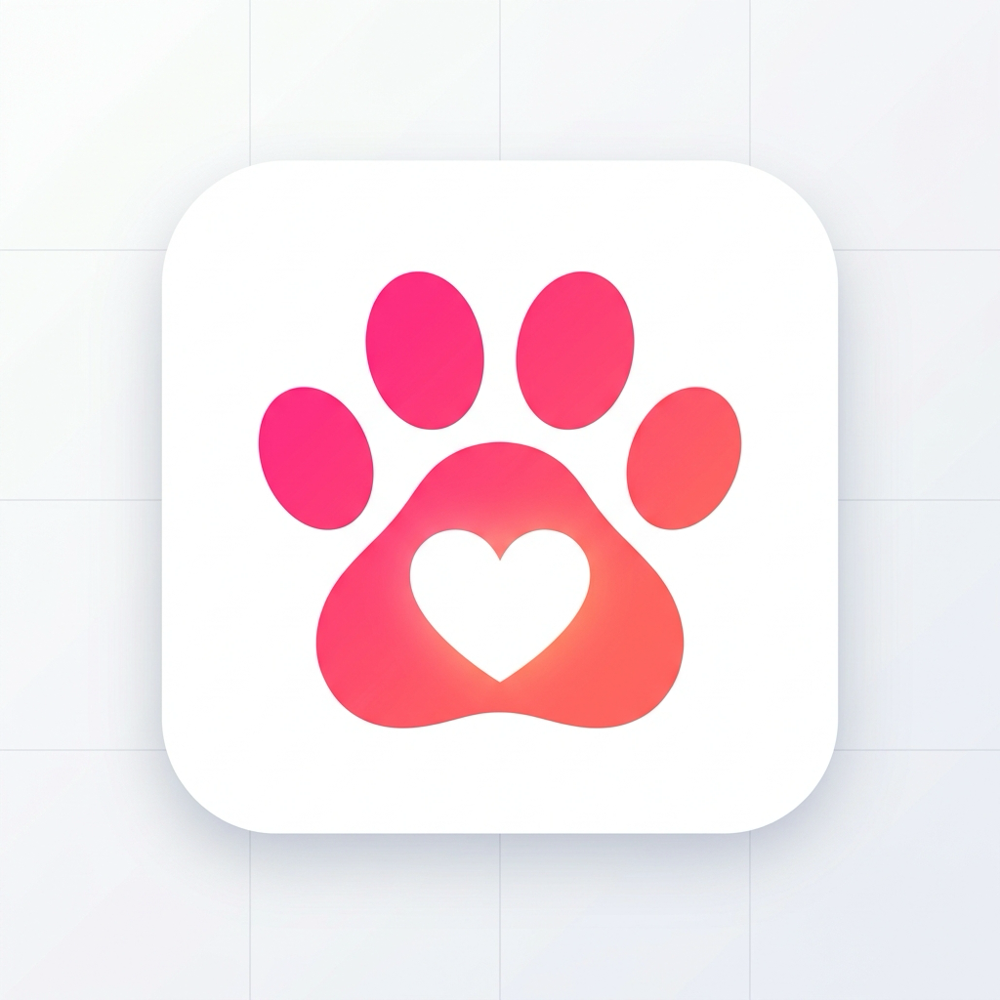
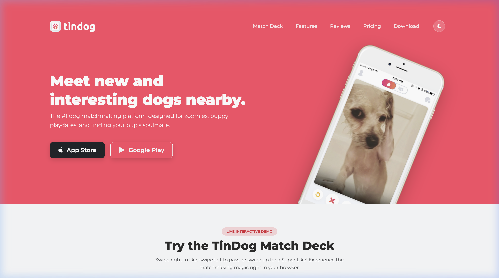
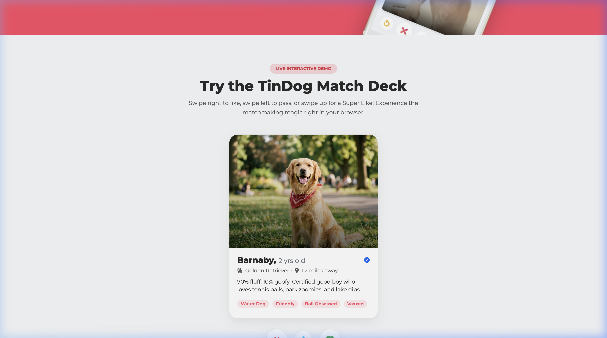
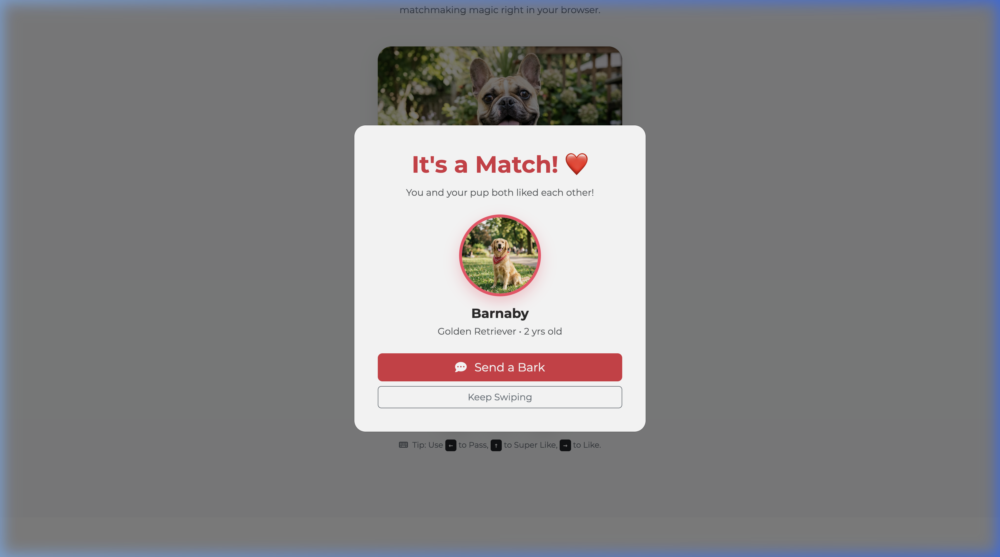
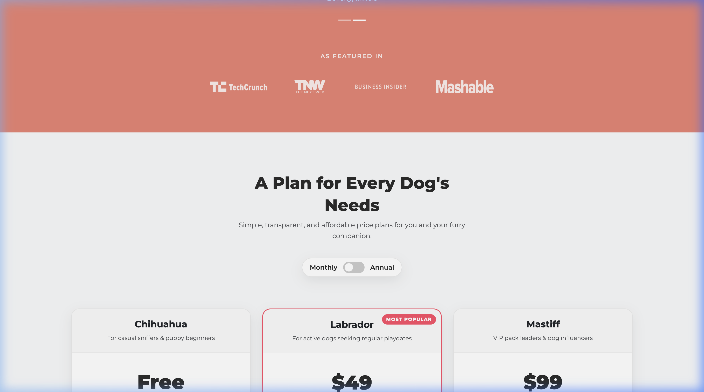
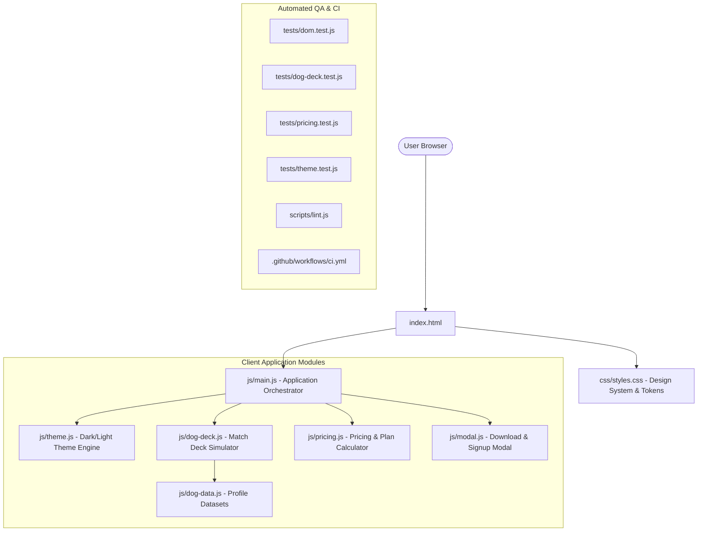

# TinDog 🐾

<div align="center">



### The Premier Matchmaking & Social Discovery Web Platform for Dogs

[](LICENSE)
[](tests/)
[-blue.svg)](package.json)
[](js/)

**Meet new and interesting dogs nearby. Designed for puppy playdates, park zoomies, and lifelong companionship.**

[Live Walkthrough](#application-walkthrough) • [Features](#core-features) • [Architecture](#architecture) • [Getting Started](#getting-started) • [Testing](#testing--quality-assurance)

</div>

---

## 📖 Overview

**TinDog** brings the intuitive, engaging swipe mechanics of modern social discovery apps into the world of pet companionship.

Originally built as a basic static tutorial page, **TinDog 2.0** has been re-architected into an interactive, test-driven, responsive application complete with:
- A live **in-browser Tinder card swiping simulator** with gesture drags, match animations, and keyboard controls.
- Dynamic **billing cycle pricing calculations** (Monthly vs. Annual with 20% discount rates).
- An accessible **dark/light mode engine** with `localStorage` persistence and system preference detection.
- Multi-platform **download modal** and VIP waitlist lead-capture with client-side validation.
- An automated **Vitest & JSDOM test suite** with 100% pass rates and GitHub Actions CI.

> [!NOTE]
> **Prototype & Simulation Notice**: TinDog is a portfolio-grade frontend engineering demonstration. Download buttons, waitlist email validation, and chat interactions are interactive client-side simulations; no external network requests or production app-store downloads are performed.

---

## 📸 Application Walkthrough

### 1. Hero Experience & Responsive Mobile Preview
The high-conversion landing hero with dual app store CTA buttons, responsive layout, and floating mockup animation.



---

### 2. Live Interactive Match Deck Simulator
Users can test the core matchmaking product directly in their browser. Supports mouse drag, touch swipes, keyboard arrow keys, and action buttons.



---

### 3. Match Celebration Modal
When a user likes or super-likes a profile, an interactive celebration popup triggers with dog profile details and conversational prompts.



---

### 4. Dynamic Pricing & Billing Cycle Switch
Subscribers can toggle between monthly and annual billing with live price animations and automatic discount adjustments.



---

## ✨ Core Features

### 🐶 Interactive Dog Match Deck
* **Tinder-Style Swiping**: Drag cards left to pass, right to like, or up to super-like.
* **Keyboard Hotkeys**: Use `←` (Pass), `↑` (Super Like), and `→` (Like).
* **Match Logic**: Evaluates match probabilities and triggers celebratory modals.
* **Deck Shuffling**: Empty-state handler allows instant deck reset and reshuffle.

### 💳 Dynamic Subscription Pricing
* **Billing Cycle Toggle**: Instant switch between Monthly and Annual billing.
* **Automated Discounts**: Calculates 20% savings on Labrador and Mastiff tiers.
* **Tier Comparison**: Features checklist for Chihuahua (Free), Labrador ($49/mo), and Mastiff ($99/mo).

### 🌓 Dark / Light Theme Engine
* **System-Aware**: Honors OS `prefers-color-scheme`.
* **State Persistence**: Saves selection in `localStorage`.
* **Contrast Compliance**: Tailored color tokens for high readability in both modes.

### 📱 Accessible & Mobile-First
* **Fixed Viewport Bug**: Configured `<meta name="viewport" content="width=device-width, initial-scale=1.0">`.
* **A11y Standards**: Skip-to-content anchor, semantic HTML landmarks, explicit ARIA labels on all interactive controls, and accessible `alt` text on images.

---

## 🛠️ Technology Stack

| Domain | Technology | Purpose |
| :--- | :--- | :--- |
| **Frontend Framework** | Bootstrap 5.3 + Custom CSS | Responsive grid, utility classes, and custom glassmorphism design tokens |
| **Logic & State** | Modular ES6+ JavaScript | Deck state, drag gesture listeners, pricing calculations, theme controller |
| **Typography & Icons** | Google Fonts + Font Awesome 6.5 | Montserrat & Ubuntu typography paired with vector iconography |
| **Build Tool** | Vite 6 | Lightning-fast HMR dev server and production asset bundling |
| **Testing** | Vitest + JSDOM | Automated unit and DOM regression test runner |
| **CI/CD** | GitHub Actions | Automated lint, test, and build pipeline across Node 20 and 22 LTS |

---

## 🏛️ Architecture



---

## 🚀 Getting Started

### Prerequisites
- [Node.js](https://nodejs.org/) v20.0.0 or higher (LTS recommended)
- [npm](https://www.npmjs.com/) v10.0.0 or higher

### Installation

1. **Clone the repository:**
   ```bash
   git clone https://github.com/vanimendiratta/Tindog.git
   cd Tindog
   ```

2. **Install project dependencies:**
   ```bash
   npm install
   ```

3. **Start the local development server:**
   ```bash
   npm run dev
   ```
   Navigate to `http://localhost:5173` to view the application with live reload.

---

## 🧪 Testing & Quality Assurance

The codebase includes automated unit, DOM, and integrity checks:

```bash
# Run all automated tests
npm test

# Run tests in watch mode
npm run test:watch

# Run asset and HTML standard linter
npm run lint

# Build production bundle
npm run build
```

### Verified Test Results
```text
 ✓ tests/theme.test.js (3 tests)
 ✓ tests/pricing.test.js (3 tests)
 ✓ tests/dog-deck.test.js (4 tests)
 ✓ tests/dom.test.js (8 tests)

 Test Files  4 passed (4)
      Tests  18 passed (18)
```

---

## 📁 Repository Structure

```text
tindog/
├── .github/
│   └── workflows/
│       └── ci.yml               # GitHub Actions continuous integration pipeline
├── css/
│   └── styles.css               # Production design tokens, themes, and animations
├── docs/
│   ├── images/                  # Real application screenshots
│   ├── IMPLEMENTATION_PLAN.md   # Step-by-step roadmap & acceptance criteria
│   └── PROJECT_AUDIT.md         # Comprehensive engineering audit report
├── images/                      # Optimized image assets, logos, and dog profiles
├── js/
│   ├── dog-data.js              # Curated dog profile database
│   ├── dog-deck.js              # Tinder-style card deck with gesture physics
│   ├── main.js                  # Main application bootstrap entrypoint
│   ├── modal.js                 # Modal controllers & lead-capture validation
│   ├── pricing.js               # Dynamic pricing calculator
│   └── theme.js                 # Dark / Light theme engine
├── scripts/
│   └── lint.js                  # Asset, typography, magic byte, and HTML standards validator
├── tests/
│   ├── dog-deck.test.js         # Unit tests for card swiping and matching
│   ├── dom.test.js              # Structural, modal, and accessibility tests
│   ├── pricing.test.js          # Unit tests for pricing math and toggle
│   └── theme.test.js            # Unit tests for theme switcher & storage
├── .gitignore                   # Standard ignore file for Node and OS artifacts
├── CHANGELOG.md                 # Version release history
├── CONTRIBUTING.md              # Contribution and PR guidelines
├── index.html                   # Semantic HTML5 landing page
├── LICENSE                      # MIT Open Source License
├── package.json                 # Tooling scripts and dependencies
├── SECURITY.md                  # Vulnerability disclosure policy
└── vitest.config.js             # Vitest configuration for JSDOM
```

---

## 🗺️ Roadmap

- [ ] **Sound & Haptics**: Add audio feedback on card swipes and match celebrations.
- [ ] **Breed Filtering**: Allow users to filter dog profiles in the simulator by size/breed.
- [ ] **Offline PWA Support**: Add service worker for offline caching and home-screen installability.

---

## 📄 License

This project is open-source software licensed under the [MIT License](LICENSE).

---

## 👩‍💻 Author

Crafted with ❤️ and 🐾 by **[Vani Mendiratta](https://github.com/vanimendiratta)**.
