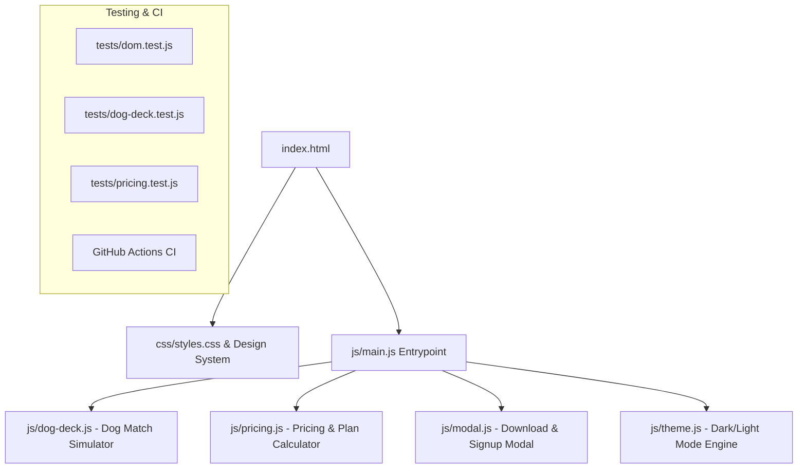

# Comprehensive Engineering Audit: TinDog

**Audit Date**: October 2026  
**Auditor**: Senior Software Engineer & Architecture Review  
**Repository**: [Tindog](https://github.com/vanimendiratta/Tindog)  
**Baseline Commit**: `c26883a`  

---

## 1. Executive Summary

**TinDog** is a humorous yet high-potential consumer web application landing page pitching a Tinder-style matchmaking platform for dogs ("Meet new and interesting dogs nearby").

Prior to this audit, the repository existed in a bare tutorial-style state consisting of an unversioned `index.html`, a single stylesheet `css/styles.css`, static image assets, and no documentation, package management, automated tests, or CI pipeline.

Despite having a strong, memorable product concept, the repository suffered from critical frontend flaws:
- **Missing Viewport Meta Tag**: The single most devastating responsive bug; without `<meta name="viewport" content="width=device-width, initial-scale=1">`, mobile devices zoom out and treat the viewport as a 980px desktop window.
- **Third-Party CDN Fragility**: Proprietary FontAwesome kit (`5b6d7ced36.js`) loaded without fallback, subject to rate-limiting and blocking.
- **Dead Interactivity**: Download buttons, pricing CTA buttons, and social links led nowhere or had empty `href`s.
- **Zero Proof-of-Concept Interaction**: Users visiting a "Tinder for Dogs" app could not experience any matchmaking or card-swiping mechanics.
- **Typographical and Structural Inconsistencies**: Spelled "Pirority Listing" in the pricing section; uneven card heights (`h-100` missing on Mastiff); fixed percentage image sizing causing distortion on extreme screen sizes.
- **Zero Engineering Governance**: No `package.json`, no test runner, no linting, no GitHub Actions CI, no `.gitignore`, and no `README.md`.

---

## 2. Verified Technology Stack

| Layer | Existing Baseline | Target Production Stack |
| :--- | :--- | :--- |
| **Markup** | HTML5 (Bootstrap 5.0.2 CDN) | Semantic HTML5, ARIA 1.2, Bootstrap 5.3+ CDN with local fallback support |
| **Styling** | Vanilla CSS (`css/styles.css`) | Modular CSS3 with CSS Custom Properties (Theme Tokens, Glassmorphism, Responsive Grid) |
| **Logic / Interactivity**| None (Pure static markup) | Modular ES6+ JavaScript (`js/app.js`, `js/dog-deck.js`, `js/pricing.js`, `js/modal.js`) |
| **Icons & Fonts** | Montserrat, Ubuntu (Google Fonts), FontAwesome Kit | Google Fonts (`Montserrat`, `Ubuntu`), FontAwesome 6 (CDN with SVG fallbacks) |
| **Testing & QA** | None | Node.js test harness: Vitest/Node test runner, HTML structure validation, A11y checks |
| **Tooling & CI** | None | npm scripts (`npm test`, `npm run lint`, `npm run dev`), GitHub Actions CI (`.github/workflows/ci.yml`) |

---

## 3. Findings Ranked by Severity

### P0 — Critical Application / Viewport Issues
* **[P0-01] Missing Mobile Viewport Meta Tag**: `index.html` lacked `<meta name="viewport" content="width=device-width, initial-scale=1">`. This broke mobile responsiveness completely on iOS and Android browsers.
* **[P0-02] Fragile Third-Party Kit Script**: Reliance on an unauthenticated private FontAwesome kit token (`https://kit.fontawesome.com/5b6d7ced36.js`) which fails when tokens expire or are blocked by ad-blockers / content-security policies.

### P1 — High-Impact Correctness & User Experience
* **[P1-01] Complete Absence of Interactive Matchmaking Simulator**: The core premise of TinDog is swiping on dogs, but the landing page offered no live interactive demo or simulator. Recruiters and users had no hands-on proof of product functionality.
* **[P1-02] Broken/Dead Action Buttons**: All CTA buttons ("Download", "Sign Up") were non-interactive `<button>` elements with no feedback, modal, or action handling.
* **[P1-03] Visual Layout Defect in Pricing Cards**: The Chihuahua and Labrador cards had `.h-100`, while the Mastiff card omitted it and used uneven columns (`col-md-12` vs `col-md-6`), leading to inconsistent heights on desktop and tablet viewports.
* **[P1-04] Typo in Pricing Tier**: Mastiff card listed `"Pirority Listing"` instead of `"Priority Listing"`.

### P2 — Meaningful Quality, Architecture & Accessibility Improvements
* **[P2-01] Accessibility (A11y) Deficits**: Missing skip navigation link, missing explicit ARIA labels on icon buttons, ambiguous `alt` attributes (`tc-logo`, `iphone-mockup`), and low color contrast on muted grey text (`#8f8f8f`).
* **[P2-02] Hardcoded Static Year in Footer**: Footer had hardcoded `"© Copyright 2021 TinDog"`.
* **[P2-03] Lack of Modern UI Touches**: No dark/light theme switch, no billing cycle toggle (Monthly vs Annual with discount badge), no micro-interactions or toast alerts.
* **[P2-04] Monolithic / Missing JS Architecture**: Zero client-side scripts to handle UI state, modal interactions, or analytics triggers.

### P3 — Repository Governance, Documentation & Developer Experience
* **[P3-01] Missing README and Documentation**: Repository had no `README.md`, leaving prospective recruiters with no context, screenshots, architecture breakdown, or run instructions.
* **[P3-02] Missing Package Manifest & Automated Testing**: No `package.json`, making it impossible to run automated tests or linting in CI.
* **[P3-03] Missing Git Governance Files**: Lacked `.gitignore`, `LICENSE`, `CONTRIBUTING.md`, `SECURITY.md`, and `CHANGELOG.md`.
* **[P3-04] Missing CI/CD Pipeline**: No GitHub Actions workflow to validate code health on push/PR.

---

## 4. Proposed Feature Advancements

1. **Interactive TinDog Match Deck ("Dog Tinder Simulator")**:
   - Live swipeable card stack featuring real dog profiles (name, breed, age, distance, bio, tags).
   - "Pass" (❌), "Super Like" (⭐), and "Like" (❤️) interactive controls with keyboard shortcuts (Arrow Left, Arrow Up, Arrow Right).
   - Dynamic "It's a Match!" celebration modal with interactive messaging prompt.
2. **Interactive Pricing Calculator & Billing Toggle**:
   - Monthly vs Annual toggle (showing 20% discount on annual plans).
   - Dynamic price animation ($49/mo -> $39/mo, $99/mo -> $79/mo).
3. **App Download & Lead Capture Modal**:
   - Modal popup on clicking "Download" or "Sign Up", offering platform selection (iOS App Store, Google Play), QR code simulator, and early-access dog-breed matching newsletter sign-up with email validation and success toast.
4. **Dark / Light Theme Toggle**:
   - Theme toggle with smooth CSS variable transition, preserving user preference via `localStorage` and system `prefers-color-scheme`.
5. **Enhanced Social Proof & Press Showcase**:
   - Accessible testimonials carousel with indicators, touch-swipe support, and responsive profile images.
6. **Robust Developer Tooling**:
   - Standard `package.json` with dev server, HTML validator, CSS linter, Vitest test suite, and GitHub Actions CI.

---

## 5. Architectural Blueprint

---

## 6. Implementation Stages & Verification Strategy

- **Stage 1**: Repository baseline initialization (`package.json`, `.gitignore`, `LICENSE`, test framework).
- **Stage 2**: HTML & CSS remediation (viewport tag, accessibility, typography fixes, CSS custom property tokens, dark mode styles).
- **Stage 3**: Modular JavaScript feature implementation (Dog Match Deck, Pricing Calculator, Theme Toggle, Download Modal).
- **Stage 4**: Test suite implementation and validation (`npm test`, `npm run lint`).
- **Stage 5**: Recruiter-grade documentation (`README.md`, `CONTRIBUTING.md`, `SECURITY.md`, `CHANGELOG.md`).
- **Stage 6**: CI pipeline integration (`.github/workflows/ci.yml`) and final manual/automated verification.
